# Pathology Bias in Phonocardiogram (PCG) Quality Filters — Project Report

**Question.** Heart-sound research pipelines use automatic *quality filters* that discard recordings or beats judged
too noisy. Pathological heart sounds (murmurs, congenital defects, irregular rhythm) can resemble noise. **At the same
noise level, do quality filters reject pathological beats more often than normal beats?**

**Short answer.** Yes for some filters and some conditions, not universally. The bias depends on the filter and the
dataset. It is strongest for (i) irregular rhythm with the segmentation-based filter (B6), and (ii) paediatric congenital
heart disease with the deep and CardioPHON-style filters (B3, B5). Part of (ii) is a heart-rate/age effect, but it does
not disappear after adjustment. The random-forest filter of Das et al. (B2) is the only one that stays fair on all 15
heartbeat conditions tested. It responds strongly to noise but is blind to pathology.

All numbers in this report come from files in `results/`; all figures are in `figures/paper/` (PNG + PDF) and are
regenerated by `src/paper_figs.py` and `src/summary_figs.py`. Deviations from the plan are listed in `DEVIATIONS.md`;
the pre-registered analysis and its logged changes are in `ANALYSIS_PLAN.md`; commands are in `REPRODUCE.md`.

---

## Contents
1. [Study design at a glance](#1-study-design-at-a-glance)
2. [Data](#2-data)
3. [Training corpus for the quality filters](#3-training-corpus-for-the-quality-filters)
4. [The quality filters (B1–B7, E6)](#4-the-quality-filters)
5. [Test beats, calibration and the clean-beat rule](#5-test-beats-calibration-and-the-clean-beat-rule)
6. [Thresholds](#6-thresholds)
7. [Experiments E0–E6](#7-experiments)
8. [Statistics](#8-statistics)
9. [Leakage control and integrity checks](#9-leakage-control-and-integrity-checks)
10. [Results](#10-results)
11. [Corrections made during the project](#11-corrections-made-during-the-project)
12. [Limitations](#12-limitations)
13. [Conclusions](#13-conclusions)
14. [File map](#14-file-map)

---

## 1. Study design at a glance

| Step | What | Key choice |
|---|---|---|
| Train | Quality filters trained **only** on PhysioNet/CinC 2016 | patient-grouped 5-fold CV |
| Test | CirCor (main), ZCHSound, BMD-HS, PASCAL B, synthetic rhythm | never used for training or tuning |
| Unit | one heartbeat (S1 onset → next S1 onset), scored in a 5 s window centred on it | ≤ 8 beats per recording |
| Fair comparison | compare only **clean** beats; add **identical** unseen noise to every beat | E2, the decisive experiment |
| Threshold | per model × dataset, reject exactly 10 % of clean normal **calibration** beats | calibration patients excluded from evaluation |
| Inference | patient-level bootstrap CIs; GEE logistic regression clustered by patient; Holm across models | adjusted for heart rate and age |

Hardware: one RTX 3060 (12 GB), i5-13400F, 32 GB RAM. Python 3.12, PyTorch 2.6, scikit-learn, statsmodels, pyPCG.
Fixed seed 42 throughout.

---

## 2. Data

### 2.1 Training data — PhysioNet/CinC Challenge 2016
* 3,153 recordings (subsets a–f), 19.7 h, 2 kHz; normal/abnormal labels; expert signal-quality labels
  (`annotations/updated/*/REFERENCE_withSQI.csv`, SQI 1 usable / 0 unusable); hand-corrected state annotations
  (S1, systole, S2, diastole) with noise stretches bracketed `(N … N)` (428 stretches).
* **Patients.** Subject IDs exist only in subset b → patient = subject (subset b) or recording (other subsets); 2,769 patient groups.
* **Folds.** `StratifiedGroupKFold` (5 folds, seed 42), stratified by abnormal × SQI, grouped by patient (`manifests/physionet2016.csv`).

### 2.2 Test data (never trained on)

| Dataset | Population | Recordings | Patients | Beat source | Classes used |
|---|---|---|---|---|---|
| CirCor DigiScope 1.0.3 (main) | children, Brazil | 3,163 | 942 | expert `.tsv` segmentation | normal (murmur absent + outcome normal), systolic murmur, diastolic murmur (audible locations), murmur patient – other location, murmur unknown, no murmur + abnormal outcome |
| ZCHSound (clean subset) | children 0–14 y, China | 941 | 941 (1 rec/pt) | Springer LR-HSMM, paediatric HR prior | control, ASD, VSD, PFO, PDA |
| BMD-HS | adults, Bangladesh | 872 | 109 | Springer LR-HSMM | normal, AS, AR, MR, MS, multi-valve |
| PASCAL B | adults (clinical) | 461 labelled | 165 | Springer LR-HSMM | normal, murmur, extrasystole |
| Synthetic rhythm | built from clean normal CirCor beats | 300 sequences | 200 | constructed | premature beats, AF-like irregular RR |

Sources: CirCor from the PhysioNet S3 mirror; ZCHSound from the authors' GitHub LFS mirror (official site unreachable);
BMD-HS from `github.com/sani002/BMD-HS-Dataset`; PASCAL B from the Kaggle mirror. All audio resampled to 2 kHz mono
float32 (`scipy.signal.resample_poly`; never upsampled).

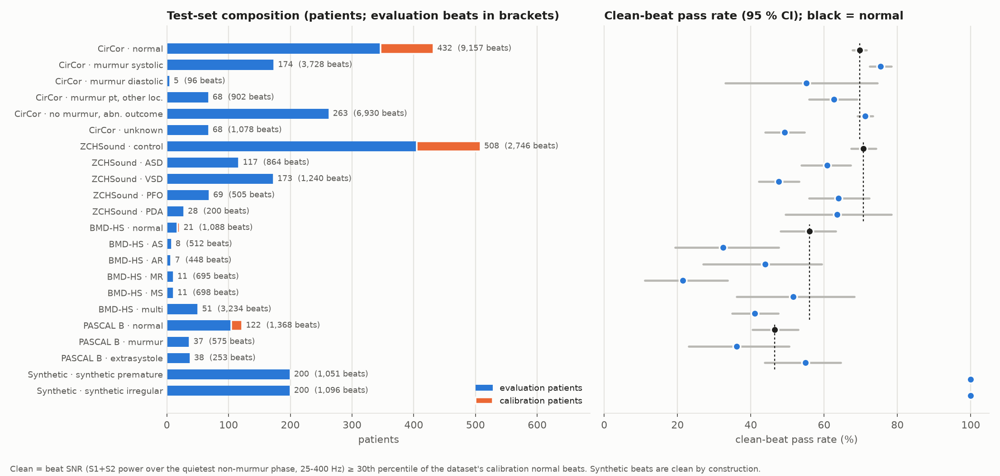

### 2.3 Noise banks
* **Bank 1 (training augmentation only):** ESC-50 (1,999 clips), Mini LibriSpeech dev-clean-2 (1,089 utterances, ≤ 12 s),
  PhysioNet `(N…N)` stretches ≥ 1 s (419). 20 Hz high-pass, unit RMS. Each clip is assigned to a PhysioNet fold
  (noise stretches inherit their record's fold) so augmentation never mixes noise across folds.
* **Bank 2 (E2 test noise only, unseen by every model):** LibriSpeech test-clean (2,620 utterances) and DEMAND
  (17 environments, 16 kHz, channel 1, 170 × 30 s clips). Disjoint speakers and files from Bank 1 (asserted).
* File lists: `manifests/noise_banks.csv`.

---

## 3. Training corpus for the quality filters

`src/make_windows.py` → `data/processed/pn_windows*.{npy,csv}`

1. 5 s windows (10,000 samples) with 2.5 s hop over every PhysioNet record.
2. **Unusable** if the record has SQI 0, or ≥ 50 % of the window lies inside a `(N…N)` stretch.
3. **Usable** if the record has SQI 1 and the window has no overlap with any noise stretch. Other windows are dropped.
4. **Augmentation:** for 30 % of usable windows a copy is made, a Bank 1 clip **from the same fold** is added at
   SNR ~ U[−5, 5] dB, and the copy is labelled unusable.
5. Windows stored peak-normalised (float16); all models are gain-invariant.

Result: **30,173 windows** — 21,694 usable, 2,012 real unusable, 6,467 augmented unusable.

### 3.1 E0 label check (done first)

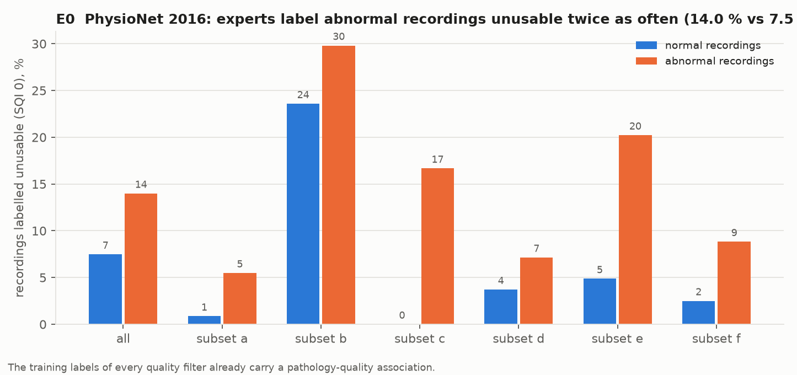

Experts labelled **14.0 %** of abnormal recordings unusable vs **7.5 %** of normal ones (subset e: 20.2 % vs 4.9 %;
`results/e0_label_check.csv`). The training labels of every quality filter therefore already associate pathology with
"bad quality".

---

## 4. The quality filters

Score convention: higher = more likely unusable. Configs: `configs/*.yaml`.

| ID | Model | Implementation (exact) | Training |
|---|---|---|---|
| **B1** | Springer SQIs + LR / SVM (Springer et al. 2014/2016) | 25–400 Hz Butterworth order 4 (zero-phase), z-score; 5 SQIs: kurtosis, Hilbert-envelope SD, max envelope autocorrelation at 0.5–2 s lag (20 Hz LP envelope at 50 Hz), envelope sample entropy (30 Hz, m = 2, r = 0.2), pyPCG cyclostationary periodicity. StandardScaler + logistic regression (balanced) / RBF-SVM (balanced, Platt, 12k-window subsample) | 5-fold CV + final |
| **B2** | Das et al. 2017 features + random forest | Hilbert envelope → LP 20 Hz (2nd order) → 50 Hz → autocorrelation → LP 10 Hz filtfilt. 11 features: autocorrelation sample entropy, kurtosis, variance; min s₂/s₁ singular-value ratio over cycle-length reshapes (0.4–1.5 s); envelope power; correlation with least-squares fits of 1, 2, 3 rectified sinusoids (f₀ grid 0.5–3 Hz); log power ratio 0–240 / 240–1000 Hz; mean and variance of log(0–500 Hz / rest) over 2 s frames, 0.5 s overlap. RF 120 trees, `max_features='sqrt'`, balanced | 5-fold CV + final |
| **B3** | CardioPHON (Despotovic et al.) | 416 features **re-implemented** from the repository's feature names (no extraction code was published): time-domain/LPC/LSF/entropies, wavelet energies/entropies, YIN F0 stats, truncated-autocorrelation entropies and peaks, Welch spectrum shape incl. 4-component GMM, two HSMM segmentations (Springer timing / population timing), 7 envelope types (variance, sample entropy, cycle correlation, HR stability), PSD band ratios, 14 MFCC statistics, peak-window plausibility. Input 1 kHz, extended to 6 s by concatenation. Published classifier: standardise → mutual-information top 20 % (83 features) → soft vote of grid-searched RBF-SVM (8k subsample), RF 200, gradient boosting 200; no class weights | 5-fold CV + final |
| **B4** | CNN (study baseline) | 20 Hz HP, per-window z-score → log-mel 64 bands 20–1000 Hz, 25 ms window, 10 ms hop (GPU); 4 × [Conv3×3–BN–ReLU–MaxPool2×2] (32, 64, 128, 128) → GAP → dropout 0.3 → linear. Adam 1e-3, batch 64, class-weighted BCE, ≤ 50 epochs, early stopping (patience 5) | train folds 1–4, validate fold 0 |
| **B5** | CRNN (study baseline) | blocks 1–2 as B4; blocks 3–4 pool frequency only → BiLSTM 2 × 64 → mean over time → linear | as B4 |
| **E6** | balanced CNN (mitigation) | B4 with weighted sampling so usable windows are 50/50 normal vs abnormal recordings | as B4 |
| **B6** | PCGKolect U-Net + HMM | released checkpoint (not retrained): 20 Hz HP, 128-pt STFT hop 40, 32 mel 25–900 Hz, log − mean / 4 → 1-D U-Net → 5-state posteriors → duration-constrained Viterbi → beats with confidence. Beat window reflection-padded to 10,328 samples. **B6a:** 1 − confidence of the decoded beat overlapping the reference beat ≥ 50 % (no match → 1). **B6b:** also 1 if beat length ∉ [0.3, 2.0] s or > 30 % off neighbours | none (trained on PhysioNet + CirCor segmentation) |
| **B7** | SNR rule (Giordano et al. 2021) | −SNR dB, SNR = power(S1+S2) / power(quietest diastole) in the window, 25–400 Hz, reference segmentation positions | none |

B6pn: B6 retrained by the authors' recipe on PhysioNet only (sensitivity analysis, §10.10).

### 4.1 Validation on PhysioNet

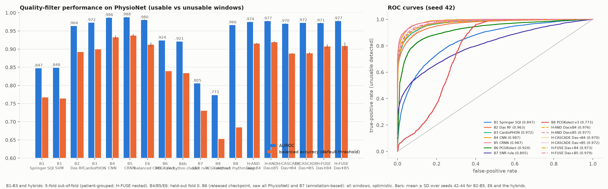

| Model | Evaluation | AUROC | Balanced acc. | EER |
|---|---|---|---|---|
| B1 LR / SVM | 5-fold OOF | 0.847 / 0.848 | 0.767 / 0.764 | 0.233 / 0.224 |
| B2 RF | 5-fold OOF | 0.963 | 0.892 | 0.102 |
| B3 CardioPHON (re-impl.) | 5-fold OOF | 0.972 | 0.899 | 0.091 |
| B4 CNN | fold 0 | 0.987 | 0.936 | 0.064 |
| B5 CRNN | fold 0 | 0.987 | 0.935 | 0.061 |
| E6 balanced CNN | fold 0 | 0.982 | 0.915 | 0.075 |
| B6a / B6b | all windows (optimistic) | 0.924 / 0.921 | 0.839 / 0.834 | 0.141 / 0.144 |
| B7 | all windows (annotation-based) | 0.805 | 0.730 | — |

`results/b_quality_performance.csv`; per-epoch / per-fold logs in `logs/train/`; `figures/paper/fig19b_training_curves.png`;
B3 feature ranking `figures/paper/fig19c_b3_feature_ranking.png`.

---

## 5. Test beats, calibration and the clean-beat rule

`src/prep_test.py` (one call per dataset), `src/segmenter.py`.

1. **Split first.** For each test dataset, 20 % of *normal* patients (seeded) become **calibration** patients; all others are
   **evaluation** patients. The split is saved in `manifests/<dataset>.csv` before any beat is cut. Calibration patients
   are used only for thresholds and the clean cut-off. CirCor 86, ZCHSound 103, BMD-HS 4 and PASCAL 18 calibration patients.
2. **Segmentation.**
   * CirCor: expert `.tsv` (1 = S1, 2 = systole, 3 = S2, 4 = diastole, 0 = unannotated).
   * Other datasets: Springer LR-HSMM (pyPCG port) trained once on 400 random SQI-1 PhysioNet records (hand-corrected S1/S2
     centres), run at 1 kHz with per-recording heart-rate/systole re-estimation. Heart-rate search range by population:
     adults (BMD-HS, PASCAL) 30–120 bpm (pyPCG default), children (ZCHSound) 30–220 bpm (§11.2).
3. **Beats** = S1 onset → next S1 onset with S1, systole, S2, diastole contiguous and fully annotated; duration 0.3–2.0 s
   (others counted as segmentation failures, `results/d_segmentation_failures_*.csv`). At most 8 beats per recording
   (random, seed from the recording ID).
4. **Window**: 5 s centred on the beat midpoint, reflection-padded at recording edges.
5. **Clean-beat rule.** Beat SNR = power(S1+S2) / power(quietest phase that is not the murmur phase), 25–400 Hz.
   Non-murmur and systolic-murmur beats use diastole; diastolic murmurs use systole; murmurs in both or unknown phase
   use the quieter phase. A beat is **clean** if SNR ≥ the 30th percentile of SNR among the dataset's calibration
   normal beats (CirCor cut-off 10.1 dB).
6. **Synthetic rhythm sets** (from 300 clean normal CirCor evaluation recordings): 20 s sequences of the recording's clean
   beats. *Premature:* 20 % of beats shifted early by 25–40 % of the previous RR with a compensatory pause.
   *AF-like:* every RR drawn uniformly within ±30 %. Durations change only through the diastole (trim or reflected
   extension). Up to 4 modified beats per sequence are scored (1,051 premature, 1,096 AF-like).

---

## 6. Thresholds

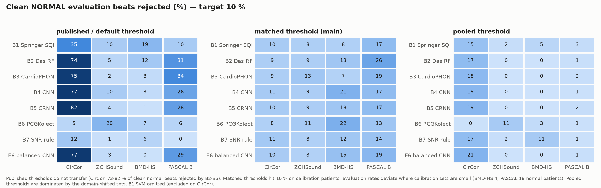

* **Published / default:** 0.5 on the probability; B6 confidence 0.80 (score 0.20); B7 SNR 14 dB (score −14).
  These do **not** transfer: on clean normal CirCor beats the 0.5 threshold rejects 73–82 % for B2–B5.
* **Matched (main analysis):** per model × dataset, the 90th percentile (an observed value) of the scores of clean normal
  **calibration** beats; beats exactly at the threshold are rejected with the probability that makes calibration rejection
  exactly 10 % (deterministic per beat ID, identical across noise levels). **Exception (option A):** if more than 5 % of
  the calibration beats sit exactly on the threshold, every tied beat is rejected (calibration rejection then exceeds 10 %).
  This applies only to B6 on ZCHSound (17.5 % of calibration beats unmatched, score 1.0) and to the B6pn variants.
  The synthetic sets use CirCor's thresholds.
* **Pooled (sensitivity):** patient-weighted 90th percentile over all four datasets' calibration normals.

---

## 7. Experiments

| Exp | Definition | Output |
|---|---|---|
| **E0** | SQI-0 rate, normal vs abnormal, PhysioNet | `results/e0_label_check.csv` |
| **E1** | all evaluation beats as recorded; rejection rate per model × dataset × class × threshold | `results/e1_raw.csv` |
| **E2** (decisive) | clean evaluation beats only; per beat, a Bank 2 clip (source 50/50 speech/DEMAND, clip and offset seeded by the beat ID) added to the 5 s window at SNR 20, 10, 5, 0 dB relative to the clean window power, plus no noise; the same noise segment at every level | `results/e2_equal_noise.csv` |
| **E3** | breakdowns: CirCor murmur grade / timing / shape; BMD-HS disease present; ZCHSound diseases; PASCAL extrasystole; synthetic rhythm | `results/e3_breakdown.csv` |
| **E4** | pooled pathological vs normal gap per dataset (E1 and each E2 level) | `results/e4_by_dataset.csv` |
| **E5** | murmur classifier (B4 architecture) on CirCor; non-calibration patients split 60/40; train unfiltered or with each filter's rejected training beats removed; test unfiltered; patient score = mean over beats; threshold = Youden J on 15 % held-out training patients; 3 seeds | `results/e5_downstream.csv`, `e5_downstream_seeds.csv` |
| **E6** | (a) B6a vs B6b (rhythm check); (b) E6 balanced CNN vs B4 | `results/e6_mitigation.csv` |

Example of the E2 protocol on one beat:

---

## 8. Statistics

* **Rates and gaps:** rejection rate per group; 95 % CI by bootstrap over **patients** (1,000 resamples, seed 42).
  Gap = pathological − normal, with pathological and normal patients resampled independently.
* **Main test (E2):** GEE logistic regression, binomial, **exchangeable** working correlation, clusters = patients:
  `rejected ~ pathological + C(SNR level)`, per model × dataset × class, at the matched threshold.
  Noise levels with no variation in a contrast (e.g. 100 % rejection at 0 dB) are dropped from that fit.
  If the exchangeable fit fails to converge, independence correlation is used. An independence-correlation fit is
  reported for every row as a sensitivity check (`or_indep`).
* **Adjusted model:** `+ hr_z + hr_z² + C(age category)`. Heart rate = 60 / beat duration. Age: CirCor category;
  ZCHSound binned into the same categories from age in days; BMD-HS 10-year bins (not identifiable: all healthy subjects 20–29); PASCAL none.
* **Multiplicity:** Holm across the 10 main models, per dataset × class contrast (and per adjustment).
  B6pn variants are reported outside the Holm family.
* Counts per group: `results/fix4_counts.csv`.

---

## 9. Leakage control and integrity checks

* `src/leakage.py::check_leakage()` (run after Phase A, before Phase E and at the end): no test record/patient in any
  training manifest; no patient in two splits/folds; no calibration patient in E5 or in any evaluation table; no Bank 2 file
  or LibriSpeech speaker in Bank 1.
* `src/verify.py` (25 checks, all pass): augmentation clips from the window's own fold (including PhysioNet noise stretches);
  fold-0 patients disjoint from folds 1–4; beat/patient/split consistency with manifests; unique beat IDs; synthetic beats
  only from evaluation patients; clean cut-offs and matched thresholds reproducible from calibration data alone;
  every score array aligned with its index and finite; one Bank 2 clip per beat across levels; E5 train/test disjoint and
  free of calibration and murmur-Unknown patients; B6 matches ≥ 95 % of CirCor reference beats; PhysioNet window labels follow the rules.
* Caveat that cannot be removed by design: the released B6 checkpoint saw CirCor segmentation labels (addressed by B6pn, §10.10).

---

## 10. Results

### 10.1 Why filters differ: noise sensitivity vs pathology sensitivity

* **Left:** every filter detects added noise on every dataset (AUROC clean vs 0 dB of the same beats 0.83–1.00).
* **Right:** a perfectly fair filter scores pathological and normal clean beats identically (AUROC 0.5). Where a filter
  scores pathology as "less usable" (red), it will reject it more. B3/B4/B5 do this for ZCHSound PFO (0.76–0.81); B6 for
  valve disease and synthetic rhythm (up to 0.91). **B2 stays at 0.47–0.64 everywhere.** Its forest needs *both* spectral
  change and loss of rhythmic periodicity. Murmurs add energy inside a still-regular cycle, while noise destroys the cycle.

### 10.2 E1 — raw rejection (as recorded)

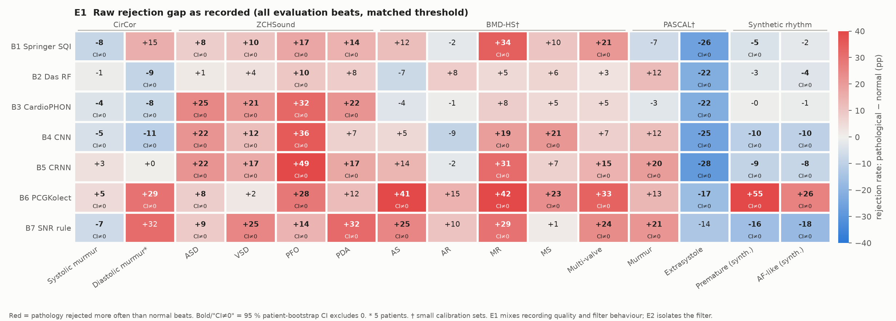

As recorded, gaps mix recording quality with filter behaviour. ZCHSound PFO: +10 to +49 percentage points (pp) across filters.
BMD-HS multi-valve: up to +34 pp (confounded: healthy subjects were recorded in a lab). PASCAL extrasystole is rejected
*less* than normal by every filter.

### 10.3 E2 — equal conditions (decisive)

Gap on **clean** beats with identical conditions:

At 10 dB added noise:

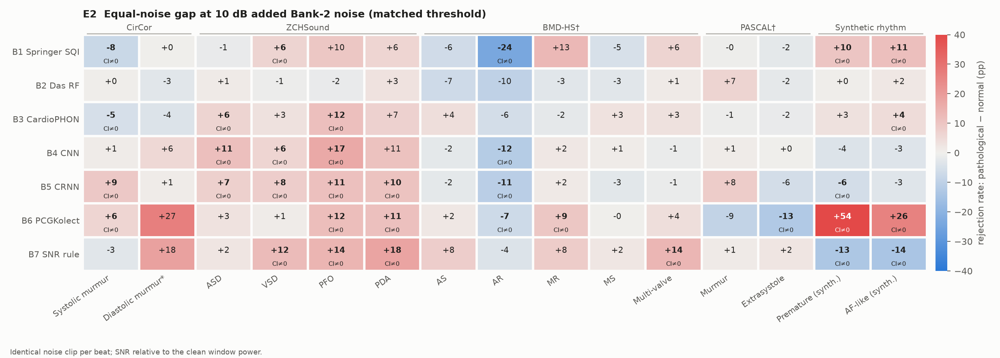

Evolution with noise for the key contrasts:

Main contrast, **CirCor systolic murmur − normal** (pp, 95 % CI, matched threshold; B1 SVM excluded on CirCor, §11.1):

| model | clean | 20 dB | 10 dB | 5 dB | 0 dB |
|---|---|---|---|---|---|
| B1 LR | −3.8 (−5.8, −1.7) | −4.7 (−6.7, −2.4) | −7.5 (−10.4, −4.6) | −9.0 (−12.6, −5.1) | −2.0 (−5.1, +1.5) |
| B2 RF | −0.2 (−2.3, +2.1) | −0.4 (−2.6, +1.9) | +0.4 (−2.3, +3.4) | +2.7 (−0.8, +6.5) | +2.3 (−0.5, +5.1) |
| B3 CardioPHON | −2.9 (−5.0, −0.6) | −3.0 (−5.2, −0.5) | −5.1 (−7.8, −2.3) | −5.9 (−9.6, −2.2) | −3.2 (−6.7, +0.4) |
| B4 CNN | −2.7 (−5.2, −0.4) | −2.4 (−5.1, +0.2) | +0.9 (−2.9, +4.7) | +0.6 (−2.1, +3.4) | +1.2 (−0.8, +3.3) |
| B5 CRNN | +6.2 (+2.4, +10.4) | +7.1 (+3.3, +11.2) | +9.2 (+4.7, +13.7) | +7.1 (+3.6, +10.7) | +4.6 (+2.3, +7.0) |
| E6 bal. CNN | −1.8 (−4.4, +0.8) | −1.6 (−4.2, +0.9) | −2.4 (−5.7, +1.2) | +0.9 (−1.8, +3.7) | −0.1 (−2.3, +2.1) |
| B6a | +6.8 (+3.4, +10.9) | +5.7 (+2.4, +9.7) | +6.0 (+1.8, +10.7) | +4.3 (+0.7, +8.0) | +0.9 (−0.7, +2.6) |
| B6b | +6.8 (+3.4, +10.8) | +5.3 (+2.0, +9.6) | +5.5 (+1.3, +10.2) | +4.4 (+0.9, +8.1) | +0.9 (−0.8, +2.6) |
| B7 SNR | −2.6 (−5.3, +0.2) | −3.3 (−6.4, −0.2) | −2.9 (−6.5, +1.1) | −2.3 (−5.5, +1.0) | −2.2 (−4.7, +0.4) |

Gaps shrink at 0 dB because nearly every beat is rejected (ceiling).

### 10.4 Statistical verdict (GEE, adjusted for heart rate and age)

| Filter | Over-rejects (significant, adjusted) | Under-rejects | Fair |
|---|---|---|---|
| B6 PCGKolect | premature (OR 19.8), AF-like (3.5), diastolic murmur (3.8), MR (4.8), MS (2.6), multi-valve (2.9) | — | 9 |
| B5 CRNN | systolic murmur (1.31), VSD (1.66), PFO (2.50), MR (3.34) | AR, premature, AF-like | 8 |
| B3 CardioPHON | ASD (2.23), PFO (3.78), premature (1.25), AF-like (1.23) | — | 11 |
| B1 Springer SQI | premature (1.41), AF-like (1.81) | systolic murmur (0.78), AR | 11 |
| B7 SNR rule | VSD (1.65) | premature, AF-like | 12 |
| B4 CNN | — | premature, AF-like | 13 |
| B2 Das RF | — | — | 15 |

Full table with CIs, unadjusted and adjusted fits, and independence-correlation sensitivity:
`results/fix4_gee_e2_covariates.csv`; unadjusted main test `results/f_gee_e2.csv`; scorecard `results/summary_scorecard.csv`.

### 10.5 Heart-rate and age confound

ZCHSound PFO patients are mostly infants (72 % infants + 6 % neonates vs 12 % infants among controls) with faster
heart rates (median 130 vs 103 bpm). Adjustment removes the PFO effect for B4 (3.33 → 1.11), B1 SVM (2.44 → 1.29) and
E6 (5.62 → 2.09). It survives for **B3 (4.25 → 3.78)** and **B5 (6.71 → 2.50)**, and within heart-rate bands the PFO gap
stays positive for B3/B4/B5/E6 in most bands (`results/fix3_hr_band_gaps.csv`). PDA is not significant for any model
after adjustment. B6 over-rejects PFO before adjustment (OR 2.74) but not after heart-rate + age adjustment (OR 1.58,
n.s.), consistent with its adult beat-duration limits failing on fast infant heart rates. On CirCor, B5's
systolic-murmur over-rejection (OR 1.31) and B1 LR's under-rejection (OR 0.78) survive.

### 10.6 E3 — murmur grade and timing (CirCor)

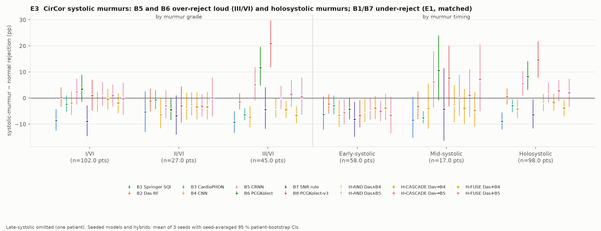

B5 and B6 over-reject loud (grade III/VI: +7.2 and +11.6 pp, E1) and holosystolic murmurs (+7.0, +8.3 pp); B1, B3, B4
and B7 reject systolic murmurs *less* than normal. The late-systolic group is a single patient and is not interpreted.
BMD-HS (E2 clean, disease present): B6 +24 to +32 pp, B1 +11 to +25 pp, B7 +15 to +17 pp for AS/AR/MR/MS alike.

### 10.7 E4 — by dataset

Pooled pathological − normal gap (matched threshold), `results/e4_by_dataset.csv`:

| Dataset | E2 clean: range across filters | Largest |
|---|---|---|
| CirCor | −3.7 to +7.3 pp | B6 +7.3, B5 +6.2 |
| ZCHSound | +3.3 to +19.6 pp | B3 +19.6, B5 +19.0, E6 +18.9, B4 +15.5 |
| BMD-HS (supportive) | −4.8 to +26.9 pp | B6 +26.8, B1 SVM +15.7, B7 +13.6 |
| PASCAL (supportive) | −8.1 to +9.7 pp | none significant |

The bias is largest in paediatric congenital heart disease, present for B6/B7/B1 in adult valve disease, small and
model-specific in CirCor, and absent in PASCAL.

### 10.8 E5 — does filtering change downstream murmur detection?

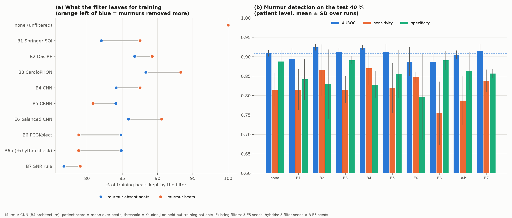

Unfiltered AUROC 0.909 ± 0.008 (3 seeds); every filter stays within ±0.02 (0.887–0.924). B5 and B6 remove murmur
training beats at a higher rate than murmur-absent beats (79–81 % vs 84–85 % kept). B6a yields the lowest murmur
sensitivity (0.755 ± 0.081 vs 0.815 ± 0.042). Filtering did not clearly change murmur detection here.

### 10.9 E6 — mitigation

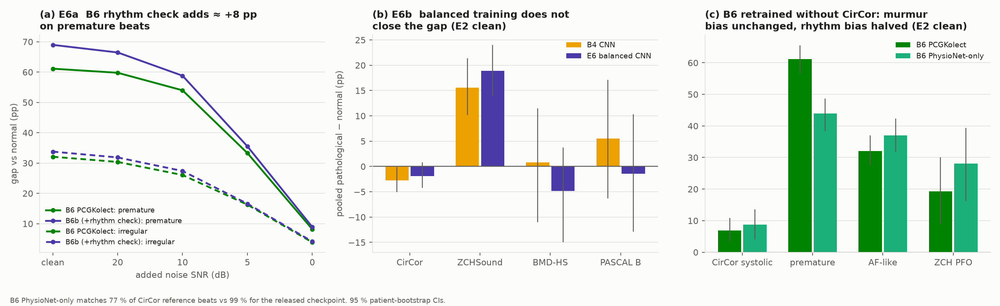

* (a) B6b's rhythm check adds ≈ +8 pp on premature beats (+69 vs +61 pp clean) and < 1 pp on natural beats. Most of B6's
  rhythm bias comes from its confidence score, not the explicit rhythm rule.
* (b) Balanced training (E6) does not close the gap: ZCHSound +18.9 vs +15.5 pp (B4); CirCor −1.9 vs −2.7; BMD-HS −4.8 vs +0.8; PASCAL −1.5 vs +5.5.

### 10.10 B6 without CirCor training

Retraining B6 on PhysioNet only (authors' recipe) leaves its CirCor systolic-murmur over-rejection unchanged (+6.6 vs
+6.8 pp clean) and halves its premature-beat over-rejection (+32 vs +61 pp). But it matches only 77 % of CirCor reference
beats vs 99 % for the released checkpoint. So B6's murmur bias is not an artefact of having seen CirCor.

### 10.11 Threshold sensitivity on the small-calibration datasets

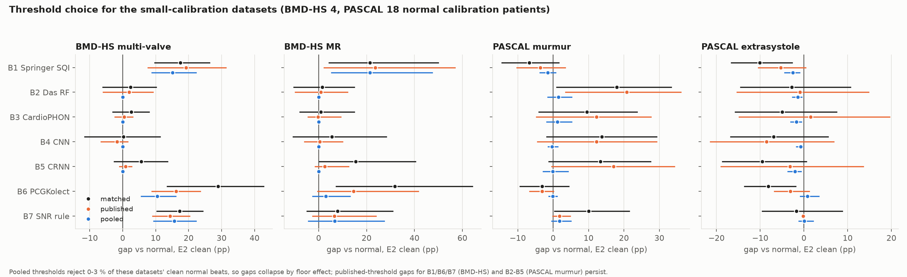

With only 4 (BMD-HS) and 18 (PASCAL) normal calibration patients, evaluation clean-normal rejection at the matched threshold
is 7–32 %. Pooled thresholds reject only 0–3 % of these datasets' clean normals, so their gaps collapse through a floor
effect. Under published thresholds the BMD-HS multi-valve over-rejection by B1/B6/B7 (+14 to +19 pp) and the PASCAL
murmur gaps for B2–B5 (+12 to +21 pp) persist. These two datasets are supportive evidence only.

### 10.12 B6 tie handling on ZCHSound (option A adopted)

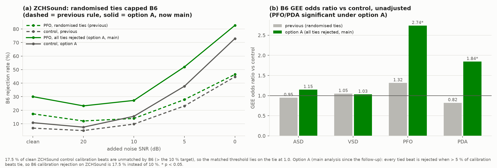

B6 gives score 1.0 to every unmatched beat. On ZCHSound, 17.5 % of clean control calibration beats are unmatched (more than
the 10 % target), so the matched threshold falls on that tie, and the original randomised tie-breaking capped B6's rejection
(e.g. ≤ 57 % of unmatched beats rejected even at 0 dB). **Option A is now the main analysis:** every tied beat is rejected
when more than 5 % of calibration beats tie (calibration rejection 17.5 %). B6 then over-rejects **ZCHSound PFO (OR 2.74,
Holm-significant; E2 clean +19 pp)** and PDA (OR 1.84, +18 pp, not significant after Holm). After heart-rate + age
adjustment the PFO effect is OR 1.58 (n.s.; heart rate alone 1.72, significant). B6's PFO bias is therefore mainly a
heart-rate effect: its adult duration priors fail on infant heart rates. The figure compares option A with the previous
randomised rule (`results/sens_b6_ties_zch.csv`).

---

## 11. Corrections made during the project

| # | Problem found | Fix | Effect on conclusions |
|---|---|---|---|
| 11.1 | B1 SVM rejection flat under noise on CirCor (~0.18 at 0 dB) | Diagnosed (not a bug): Platt-scaled SVM output saturates near 0.75 and CirCor's matched threshold (0.72) sits at that ceiling; scaler and resampling verified correct (`figures/paper/fig19a_b1svm_ceiling_circor.png`) | B1 SVM excluded on CirCor; B1 conclusions there rest on B1 LR |
| 11.2 | Springer segmenter capped at 120 bpm → infant beats merged into double-length beats (ZCHSound neonates "79 bpm") | Population-specific prior (children 30–220 bpm, systole search adapted); validated on PhysioNet only; ZCHSound fully regenerated; BMD-HS/PASCAL bit-identical | ZCHSound odds ratios moderated; conclusions kept |
| 11.3 | Deep-model scores saturated at exactly 1.0 (float32 sigmoid); ties at matched threshold | float64 scores; randomised tie-breaking to reject exactly 10 % | thresholds now exact |
| 11.4 | GEE complete separation at 0 dB | drop uninformative levels; independence fallback | all fits converge |
| 11.5 | E5 single seed, max-over-beats score, threshold 0.5 | mean over beats, Youden threshold on held-out training patients, 3 seeds | earlier B7 drop (0.86) did not replicate |
| 11.6 | Exchangeable vs independence GEE disagree for some near-null fits | both reported | one sign flip with significance (B6pn CirCor systolic) |
| 11.7 | B3 CardioPHON had no feature code | 416 features re-implemented from names | B3 approximates the published model |
| 11.8 | Randomised tie-breaking capped B6 on ZCHSound (17.5 % of calibration beats unmatched) | option A: reject all ties when > 5 % of calibration beats tie | B6 over-rejects ZCHSound PFO before adjustment (OR 2.74); explained by heart rate after adjustment |

---

## 12. Limitations

* **B3** is a re-implementation from feature names, not the original extractor; there is no as-published arm.
* **BMD-HS and PASCAL** have tiny calibration sets and (BMD-HS) a recording-condition and age confound.
* **CirCor diastolic murmur** has only 5 patients; the late-systolic group is one patient.
* **ZCHSound, BMD-HS, PASCAL** beats come from an automatic segmenter; segmentation failure rates differ by class
  (e.g. ZCHSound PDA 12.5 %, PASCAL extrasystole 6.5 %).
* **B6** saw CirCor segmentation labels (B6pn addresses this; B6pn segments CirCor poorly).
* **B7** uses oracle segmentation positions under noise and resembles the clean-beat rule itself.
* **PhysioNet folds** are by recording outside subset b (no subject IDs). Deep models use one split and one seed;
  validation fold 0 also drives early stopping.
* **Synthetic rhythm** sets are constructed from normal beats and approximate premature beats / AF only in timing.
* **B6 on ZCHSound** uses option A tie handling, so its calibration rejection is 17.5 % rather than 10 % (§10.12).

---

## 13. Conclusions

1. **Quality filters can be biased against pathology at equal noise, but whether they are depends on the filter.**
   The 7 main filters range from fair on all 15 conditions (B2) to biased on 6 (B6).
2. **Irregular rhythm** is the most systematic failure of segmentation/periodicity-based filters (B6, B1, B3): premature
   beats are rejected up to 61 pp more often. Window-level deep classifiers (B4, B5) do not show this.
3. **Paediatric congenital heart disease** is over-rejected by deep and CardioPHON-style filters (B3, B5, plus B4/E6
   before adjustment, and B6 for PFO). Part of it is heart rate/age (it explains B4, E6 and B6), but B3 and B5 remain biased
   after adjustment and within heart-rate bands.
4. **Murmurs in CirCor** show small, filter-specific effects in both directions: B5 (and B6, not significant after
   correction) over-reject loud and holosystolic murmurs, while B1/B3 under-reject.
5. **Upstream bias exists before any model:** expert quality labels (E0) and even an objective SNR-based clean rule
   pass fewer pathological recordings and beats.
6. **Thresholds do not transfer** across datasets; calibrating on local normal patients is necessary, and small
   calibration sets make conclusions fragile.
7. **Balancing training data did not mitigate the bias**, and filtering did not measurably change downstream murmur
   detection in E5.

**Practical recommendation:** before using a quality filter in pathology research, report its rejection rate per
diagnostic class on clean beats at a locally calibrated threshold (the matrix in Fig. 12a). Prefer filters that respond
to noise but are blind to pathology (here B2).

---

## 14. File map

| Path | Content |
|---|---|
| `AGENT_PLAN.md` | original plan |
| `ANALYSIS_PLAN.md` | pre-specified thresholds/metrics/tests + logged changes |
| `DEVIATIONS.md` | every deviation, one line each |
| `PROGRESS.md` | live status |
| `RESULTS.md` | compact results summary with tables and the "Fixes" section |
| `REPRODUCE.md` | commands to rerun from raw data |
| `configs/` | one YAML per model |
| `manifests/` | record/patient/split lists per dataset; noise-bank file lists |
| `src/` | all code (prep, features, models, scoring, analysis, figures, leakage/verify) |
| `results/` | every CSV behind every number |
| `logs/train/` | per-epoch / per-fold training logs |
| `figures/paper/` | the paper figure set (fig01–fig20, PNG + PDF) |
| `figures/` | working figures (E2 per dataset, summary matrices, fix diagnostics) |

### Figure index
| Figure | Content |
|---|---|
| fig01 | study pipeline |
| fig02 | test-set composition and clean-beat pass rates |
| fig03 | E0 label check |
| fig04 | model validation (AUROC, balanced accuracy, ROC) |
| fig05 | threshold transfer (published / matched / pooled) |
| fig06 | E2 protocol example on one beat |
| fig07 | noise sensitivity vs pathology sensitivity (why filters are biased) |
| fig08 | E1 raw gap heatmap |
| fig09a / b | E2 gap heatmaps, clean and 10 dB |
| fig10 | E2 gap vs SNR for key contrasts |
| fig11 | GEE forest plot, unadjusted vs adjusted |
| fig12a / b / c | verdict matrix, scorecard, gap heatmap with significance |
| fig13 | heart-rate/age confound and stratified check |
| fig14 | E3 murmur grade and timing |
| fig15 | E5 downstream murmur detection |
| fig16 | E6 mitigation and B6 retrained without CirCor |
| fig17 | recalibration for BMD-HS and PASCAL |
| fig18 | B6 tie handling on ZCHSound: option A (main) vs previous randomised rule |
| fig19a / b / c | B1 SVM ceiling, training curves, B3 feature ranking |
| fig20_* | E2 rejection vs SNR per class, one per dataset |
