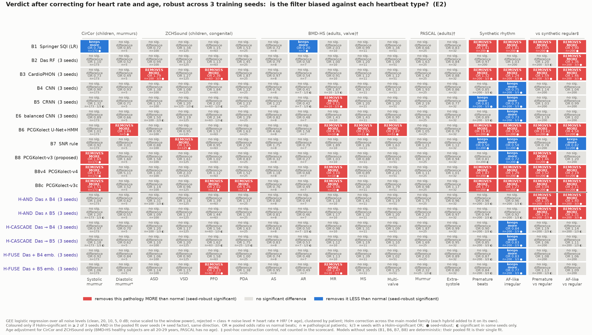
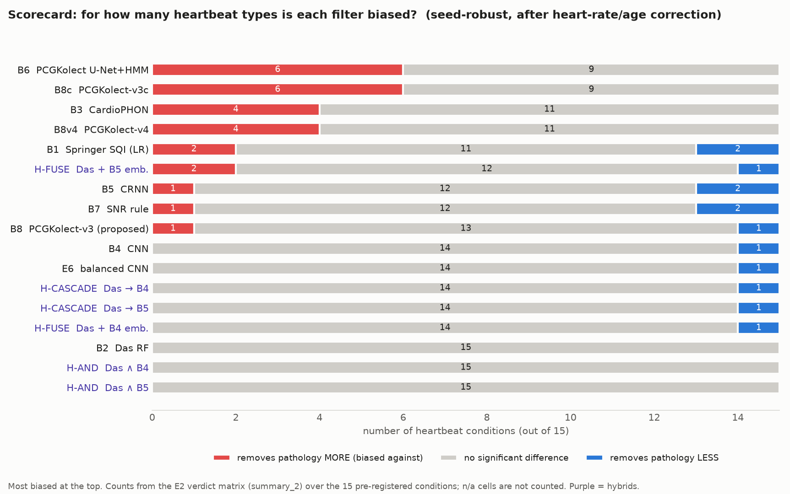
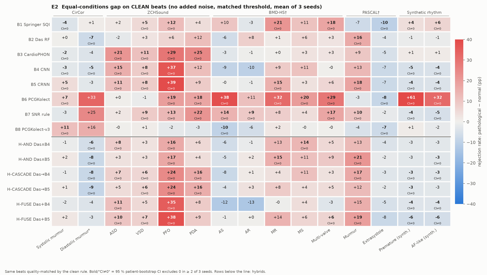
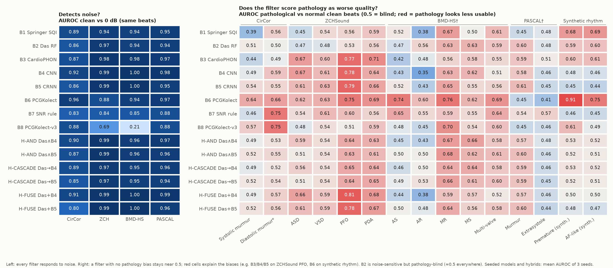
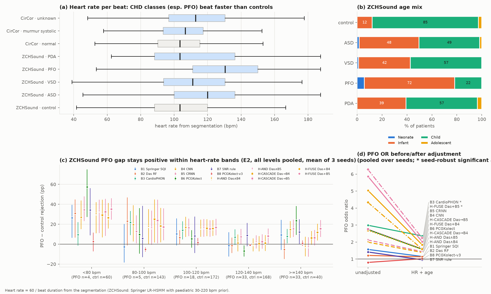
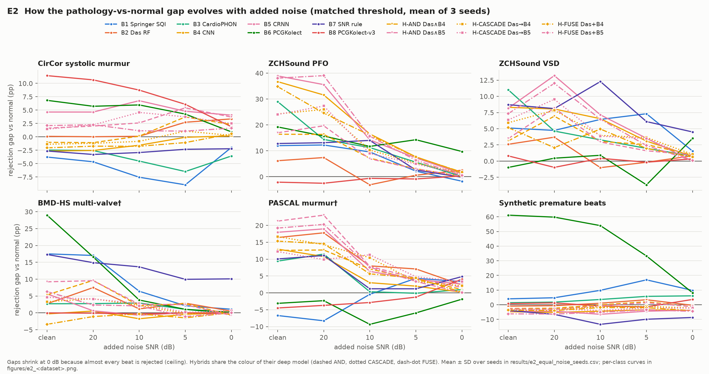
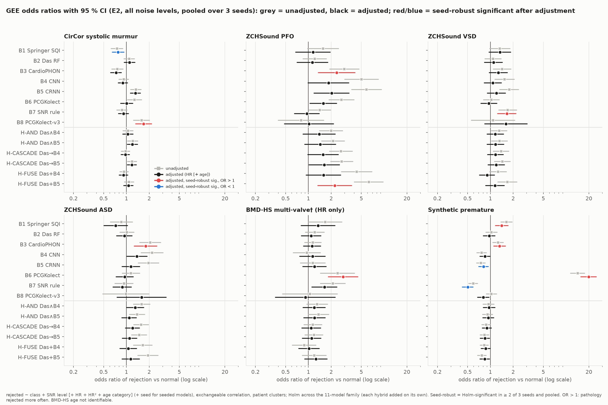
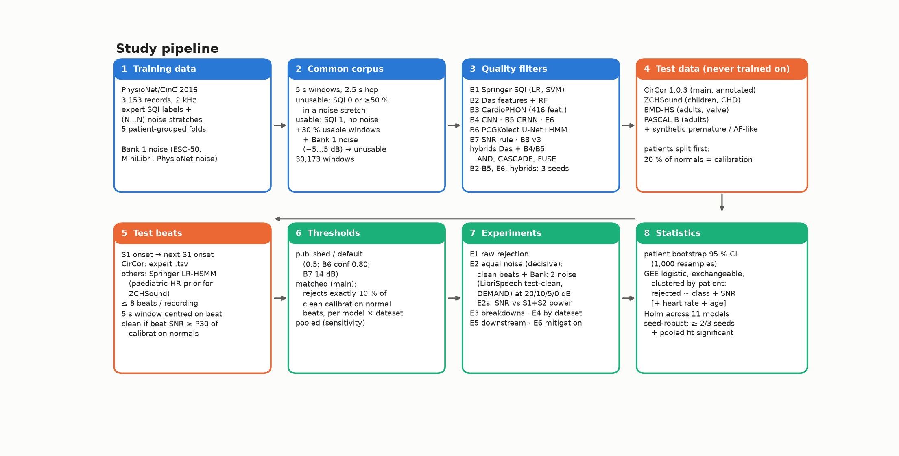
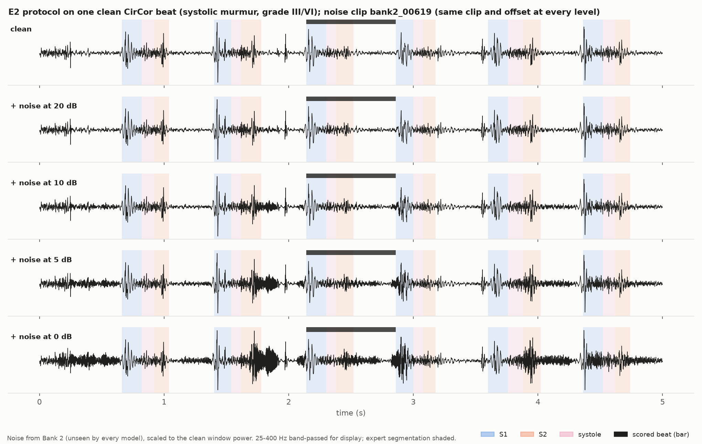

# Do heart-sound quality filters throw away the sick heartbeats?

**Pathology bias in phonocardiogram (PCG) quality filters**: an implementation and evaluation of 7 published or
baseline quality filters (plus six Das + deep-model hybrids) on 4 independent heart-sound datasets plus synthetic irregular
rhythms. Learned filters are evaluated over 3 training seeds; a bias counts only if it is seed-robust.

> Heart-sound research pipelines automatically discard recordings or beats that look "too noisy".
> Murmurs, congenital defects and irregular rhythms can look like noise.
> **At the same noise level, do these filters reject pathological beats more often than normal ones?**

---

## TL;DR

| | |
|---|---|
| **Answer** | **Sometimes, and it depends on the filter.** Over 15 heartbeat conditions and 3 training seeds, B2, B4 and E6 show no seed-robust bias, while B6 is biased against 6 conditions and B3 against 4. |
| **Worst case** | The segmentation-based filter (**B6**, U-Net + HMM) rejects **premature beats 61 percentage points more often** than normal beats, and over-rejects valve disease. |
| **Children with congenital heart disease** | All learned filters reject PFO beats far more often as recorded (B3-B5 +29 to +39 pp on clean beats, mean of 3 seeds). After heart-rate/age correction only **B3 (CardioPHON)** stays seed-robustly biased (ASD, PFO); B5's PFO effect is significant in 1 of 3 seeds only. |
| **Seeds matter** | Retraining with other seeds keeps AUROC within ±0.003 but moves deep-model gaps by up to ±7 pp; 7 of 31 seed-42 findings (3 of B5's biases, E6's ASD and three "keeps more premature" cells) do not replicate across seeds. |
| **Lowest bias** | **B2** (Das et al. features + random forest) is pathology-blind (smallest class effects) but detects less noise (47 % vs B4's 66 % of noisy normal beats rejected). |
| **Hybrid** | **H-FUSE-B4** (Das features + B4 embedding, random forest) keeps B4's noise sensitivity (65 %) with no seed-robust bias and smaller adjusted odds ratios than B4 (mean \|log OR\| 0.24 vs 0.35), but its raw clean-beat gaps stay at B4's level. B4 alone also has no seed-robust bias, so the hybrid's gain is modest. |
| **Before any model** | The expert quality labels the filters learn from already mark abnormal recordings unusable twice as often (14.0 % vs 7.5 %). |
| **Practical takeaway** | Check a quality filter's rejection rate **per diagnostic class, on clean beats, at a locally calibrated threshold** before using it for pathology research. |

---

## The result in one picture

**Is each filter biased against each type of heartbeat?** (equal noise conditions; corrected for heart rate and age; seed-robust over 3 training seeds)



**How to read it:** each cell compares how often the filter rejects that kind of heartbeat with how often it rejects
normal heartbeats from the same dataset, under identical conditions.
- 🟥 **Removes more:** the filter throws this pathology away significantly more often, so useful data is lost.
- ⬜ **No significant difference** (not significant in ≥ 2 of 3 seeds and in the pooled fit).
- 🟦 **Keeps more:** the filter rejects this pathology *less* often than normal beats.

OR = pooled odds ratio of rejection vs normal (GEE logistic regression over all noise levels, clustered by patient,
Holm-corrected across models); n = pathological patients; k/3 = seeds in which the cell is Holm-significant. Purple rows:
hybrids. The same matrix with noise scaled to the S1+S2 power (E2s) is [fig12d](figures/paper/fig12d_verdict_matrix_e2s.png).

### Scorecard



| Filter | Seed-robust "biased against" (of 15) | Noisy normal beats rejected* |
|---|---|---|
| **B2** Das et al. features + random forest | none | 47 % |
| **B4** CNN (log-mel) | none (keeps more AF-like beats) | 66 % |
| **E6** CNN, balanced training | none | 64 % |
| **H-AND** Das ∧ B4 / Das ∧ B5 | none / none | 57 % / 56 % |
| **H-CASCADE** Das → B4 / Das → B5 | none / none | 57 % / 54 % |
| **H-FUSE** Das + B4 embedding | none | 65 % |
| **B7** SNR rule (Giordano et al.) | VSD | 46 % |
| **B5** CRNN (CNN + BiLSTM) | MR | 61 % |
| **B8** PCGKolect-v3 (proposed earlier) | CirCor systolic murmur | 13 % |
| **B1** Springer SQIs + logistic regression | premature, AF-like (keeps more systolic murmurs) | 35 % |
| **H-FUSE** Das + B5 embedding | MR, PFO | 70 % |
| **B3** CardioPHON (416 features + ensemble) | ASD, PFO, premature, AF-like | 54 % |
| **B6** PCGKolect U-Net + duration HMM | premature (OR 19.8), AF-like, diastolic murmur, MR, MS, multi-valve | 34 % |

\* noise sensitivity: % of noisy normal evaluation beats rejected at 10 and 5 dB (CirCor + ZCHSound, matched threshold,
mean of 3 seeds). Higher = detects noise better. See the trade-off in [fig22](figures/paper/fig22_noise_vs_bias.png).

---

## Key findings

### 1. How big are the gaps? (clean beats, identical conditions)



Each number is the **extra rejection rate (percentage points) for that pathology compared with normal beats**, on beats
that are equally clean (mean of 3 seeds for B2-B5 and the hybrids, listed below the line). Red = removes the pathology more
often. Bold / "CI≠0" = the 95 % patient-bootstrap confidence interval excludes zero in ≥ 2 of 3 seeds.

* **Irregular rhythm** splits the filters. Filters that rely on beat segmentation or rhythm periodicity (B6, B1, B3)
  reject premature and AF-like beats more often. Window-level deep classifiers (B4, B5) do not.
* **Congenital heart disease** (ZCHSound): B3, B4 and B5 reject PFO beats +29 to +39 points more often (mean of 3 seeds).
* **Valve disease** (BMD-HS): B6 rejects AS, MR and multi-valve beats +29 to +38 points more often.
* **CirCor murmurs:** small effects in both directions. B5/B6 over-reject (+6 to +7), while B1/B3 under-reject (−3 to −4).

### 2. Why some filters are biased and others are not



**Left:** every filter detects added noise well (AUROC 0.83–1.00). **Right:** a filter without pathology bias cannot tell
pathological from normal *clean* beats (AUROC ≈ 0.5). Red cells mean the filter scores that pathology as "lower quality", and
that is exactly where the bias appears. B2 stays near 0.5 because its random forest needs both a spectral change and
a loss of rhythmic periodicity. Murmurs add energy inside a regular heartbeat; noise destroys the rhythm.

### 3. Is it just heart rate and age? (Partly.)



PFO patients are mostly infants (78 % neonates or infants vs 12 % of controls) with faster heart rates (median 130 vs
103 bpm). Correcting for heart rate and age removes the PFO effect for B6 (OR 2.74 → 1.58) and, across seeds, for the CNN
(seed 42: 3.33 → 1.11; other seeds 2.0–2.2, not significant). It **survives seed-robustly only for B3** (OR 3.4–3.8 in each
seed); B5's adjusted PFO effect (seed 42: 2.50) is significant in 1 of 3 seeds. The gap stays positive *within* heart-rate bands.

### 4. How the bias behaves as noise increases



Gaps are largest on clean and mildly noisy beats. They shrink at 0 dB only because nearly every beat is rejected
there, whatever its class.

### 5. Effect sizes with uncertainty



Grey: unadjusted. Black: adjusted for heart rate (+ age). Pooled over 3 seeds. Red/blue: seed-robust significant.

### 6. Other results

| Experiment | Result | Figure |
|---|---|---|
| **E0** Label check | Experts labelled 14.0 % of abnormal vs 7.5 % of normal PhysioNet recordings unusable | [fig03](figures/paper/fig03_e0_label_check.png) |
| Threshold transfer | Published 0.5 thresholds reject 73–82 % of clean normal CirCor beats for B2–B5, so thresholds must be calibrated per dataset | [fig05](figures/paper/fig05_threshold_transfer.png) |
| **E3** Murmur grade/timing | B5/B6 over-reject loud (grade III/VI) and holosystolic murmurs most | [fig14](figures/paper/fig14_e3_murmur_grade_timing.png) |
| **E5** Downstream | Training a murmur detector on filtered data changed AUROC by at most ±0.02 (unfiltered 0.909 ± 0.008, 3 seeds) | [fig15](figures/paper/fig15_e5_downstream.png) |
| **E6** Mitigation | B6's explicit rhythm check adds only ≈ 8 points of its 61-point premature-beat bias; balancing the training data did **not** remove the bias | [fig16](figures/paper/fig16_e6_mitigation_and_b6_retrain.png) |
| **Hybrids** | Das + B4/B5 (AND, CASCADE, FUSE): H-FUSE-B4 keeps B4's noise sensitivity with no seed-robust bias; see "Hybrid hypothesis" in RESULTS.md | [fig22](figures/paper/fig22_noise_vs_bias.png) |
| **E2s** | Noise scaled to the S1+S2 power instead of the window power: same direction of every seed-robust bias | [fig09c](figures/paper/fig09c_e2s_10dB_gap_heatmap.png), [fig12d](figures/paper/fig12d_verdict_matrix_e2s.png) |
| B6 retrained without CirCor | Murmur bias unchanged (+6.6 vs +6.8 points), so it is not an artefact of having seen CirCor | [fig16](figures/paper/fig16_e6_mitigation_and_b6_retrain.png) |

---

## How the study works



1. **Train** every quality filter only on **PhysioNet/CinC 2016**: 3,153 recordings, expert quality labels and
   marked noise stretches, cut into 30,173 five-second windows, with 5 patient-grouped folds.
2. **Test** on datasets no filter was trained on. Each recording is cut into heartbeats (S1 onset to next S1 onset),
   and each beat is scored in a 5 s window centred on it.
3. **Calibrate** each filter separately on each dataset: 20 % of normal patients are held out, and the threshold
   is set to reject exactly 10 % of their clean beats. These patients are never evaluated.
4. **Compare fairly (E2, the decisive experiment):** take only beats that pass an objective cleanliness rule. Add
   *the same* unseen noise clip to every beat (LibriSpeech test-clean or DEMAND) at 20, 10, 5 and 0 dB. Compare
   rejection rates of pathological vs normal beats.
5. **Statistics:** patient-level bootstrap CIs; GEE logistic regression clustered by patient, adjusted for noise
   level, heart rate and age; Holm correction across models. Learned filters are trained with 3 seeds; a bias counts only
   if it is significant in ≥ 2 of 3 seeds and in the fit pooled over seeds.



### Data

| Dataset | Role | Population | Size used | Classes |
|---|---|---|---|---|
| [PhysioNet/CinC 2016](https://physionet.org/content/challenge-2016/1.0.0/) | training only | mixed | 3,153 recordings | usable / unusable |
| [CirCor DigiScope 1.0.3](https://physionet.org/content/circor-heart-sound/1.0.3/) | main test | children | 942 patients, 24k beats | normal, systolic/diastolic murmur, ... |
| [ZCHSound](https://doi.org/10.1109/tbme.2023.3348800) (clean subset) | test | children 0–14 y | 941 patients | control, ASD, VSD, PFO, PDA |
| [BMD-HS](https://github.com/sani002/BMD-HS-Dataset) | test (supportive) | adults | 109 patients | normal, AS, AR, MR, MS, multi-valve |
| [PASCAL B](http://www.peterjbentley.com/heartchallenge/) | test (supportive) | adults | 165 patients | normal, murmur, extrasystole |
| Synthetic rhythm | test | built from clean normal CirCor beats | 2,147 beats | premature, AF-like irregular |
| ESC-50, Mini LibriSpeech | training noise | | | |
| LibriSpeech test-clean, DEMAND | **unseen** test noise | | | |

### Filters

| ID | Filter | Type |
|---|---|---|
| B1 | Springer et al. signal-quality indices + logistic regression / SVM | hand-crafted |
| B2 | Das et al. autocorrelation + spectral features + random forest | hand-crafted |
| B3 | CardioPHON (Despotovic et al.): 416 features, mutual-information selection, SVM + RF + GB soft vote (features re-implemented) | hand-crafted ensemble |
| B4 | CNN on log-mel spectrogram | deep |
| B5 | CRNN (CNN + BiLSTM) | deep |
| E6 | B4 trained with normal/abnormal-balanced usable data (mitigation) | deep |
| H-AND / H-CASCADE | Das (B2) and B4 or B5 percentiles: min, or Das decides outside its 0.4–0.9 percentile band | hybrid |
| H-FUSE | random forest on the 11 Das features + B4 or B5 penultimate embedding | hybrid |
| B6 | PCGKolect 1-D U-Net + duration-constrained HMM (released checkpoint) | deep segmentation |
| B7 | SNR rule (Giordano et al.) | rule |

---

## Caveats

* BMD-HS and PASCAL have very small calibration sets (4 and 18 normal patients), and BMD-HS healthy subjects were
  recorded in a lab, so treat those columns as supporting evidence only.
* B3's 416 features are re-implemented from the published feature names; the original extraction code was not released.
* ZCHSound, BMD-HS and PASCAL beats come from an automatic segmenter (Springer LR-HSMM, with a paediatric heart-rate
  range for ZCHSound).
* The CirCor diastolic-murmur group has only 5 patients.
* **B6 on ZCHSound:** B6 gives every beat it cannot match the maximum score, and 17.5 % of clean control beats are
  unmatched. All tied beats are therefore rejected there (calibration rejection 17.5 % instead of 10 %). B6 then
  over-rejects PFO (OR 2.74), but this disappears after heart-rate/age correction: its adult beat-duration limits fail
  on fast infant heartbeats ([fig18](figures/paper/fig18_sensitivity_b6_ties_zchsound.png)).

Every deviation from the original plan is logged in [`DEVIATIONS.md`](DEVIATIONS.md).

---

## Documents

| File | What's inside |
|---|---|
| [`PROJECT_REPORT.md`](PROJECT_REPORT.md) | **Full report:** exact methodology for every step, all results, corrections, limitations |
| [`RESULTS.md`](RESULTS.md) | Compact results tables, plus the "Fixes" section from the follow-up review |
| [`ANALYSIS_PLAN.md`](ANALYSIS_PLAN.md) | Pre-specified thresholds, metrics and tests, with every later change logged |
| [`DEVIATIONS.md`](DEVIATIONS.md) | Every deviation from the plan or the original papers, one line each |
| [`REPRODUCE.md`](REPRODUCE.md) | Commands to rerun everything from the raw data |
| [`AGENT_PLAN.md`](AGENT_PLAN.md) | The original study plan |
| [`figures/paper/`](figures/paper/) | paper-ready figures (PNG + PDF), incl. fig22 noise sensitivity vs bias |
| [`results/`](results/) | Every CSV behind every number |

## Repository layout

```
src/            all code: data prep, features, models, scoring, analysis, figures, leakage checks
configs/        one YAML per model
manifests/      record / patient / split lists per dataset, noise-bank file lists
results/        CSV outputs per experiment
logs/train/     per-epoch and per-fold training logs
figures/paper/  paper figure set
data/models/    trained classic models (B1, B2, B3) and the segmenter
```

Raw datasets and processed audio are not included (licences and size); `REPRODUCE.md` downloads and rebuilds them.

## Reproduce

```bash
uv venv -p 3.12 .venv
uv pip install -p .venv/bin/python torch --index-url https://download.pytorch.org/whl/cu124
uv pip install -p .venv/bin/python numpy scipy pandas scikit-learn statsmodels librosa soundfile matplotlib pyyaml pyPCG-toolbox pywavelets cython setuptools
uv pip install -p .venv/bin/python --no-build-isolation git+https://github.com/jvkersch/hsmmlearn
```

Then follow [`REPRODUCE.md`](REPRODUCE.md). The full pipeline runs in a few hours on one RTX 3060 (12 GB) and a 10-core
CPU. Integrity is checked by `src/leakage.py` (leakage asserts) and `src/verify.py` (25 checks).
